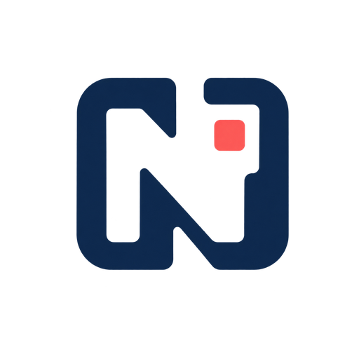
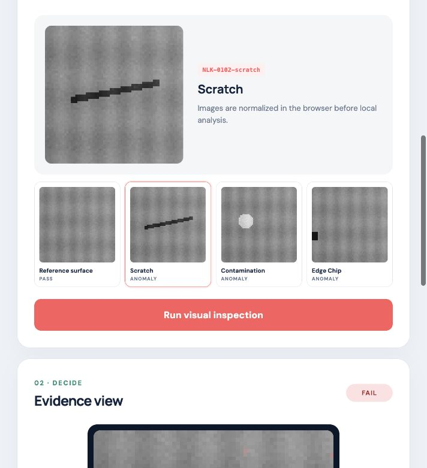
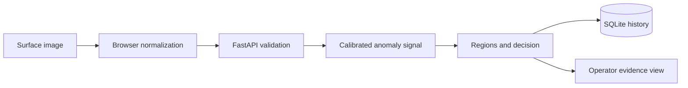

<p align="center">
  
</p>

<h1 align="center">Nilik</h1>

<p align="center">
  A local visual anomaly inspection workstation that keeps the evidence visible
  and the release decision traceable.
</p>

<p align="center">
  
  
  
  
</p>



## The moment Nilik is built for

An operator sees a mark on a product surface. The line needs an answer, but a
single unexplained model score is not enough. Nilik keeps the recommendation,
visual evidence, threshold, and review history in one local workflow so a human
can make the final quality decision.

The current release is a complete, reproducible product demonstration. It uses
synthetic surfaces because no confidential factory data is included, and it
states that boundary wherever performance is discussed.

## What an operator can do

- choose controlled reference, scratch, contamination, and edge-chip samples;
- upload a real image that is normalized locally in the browser;
- receive a `PASS`, `REVIEW`, or `FAIL` recommendation;
- inspect an anomaly heatmap and connected evidence regions;
- compare the score with the calibrated review boundary; and
- revisit persisted inspection records in the same workstation.

## How the system works



The detector combines local contrast residuals and gradient discontinuities.
Its decision boundary is calibrated from known-good generated references, then
verified on a separate seeded evaluation set. [Read the architecture](docs/architecture.md)
or [review the engineering decision](docs/decisions/001-explainable-baseline.md).

## Run locally

Requirements: Python 3.12, Node.js 24, pnpm 11, and `uv`.

```bash
git clone https://github.com/abiekaputra/nilik.git
cd nilik
pnpm setup
pnpm dev
```

Open [http://127.0.0.1:4610](http://127.0.0.1:4610). The API documentation is
available at [http://127.0.0.1:4600/docs](http://127.0.0.1:4600/docs).

## Validate the release

```bash
pnpm quality
```

The command checks formatting, source limits, linting, TypeScript, unit tests,
coverage, the deterministic evaluation gate, and the production build.

The held-out synthetic benchmark currently reports precision, recall, and F1
of `1.000` across 48 samples. This is a regression signal for the controlled
generator. It is not a production accuracy claim. See
[quality and evaluation](docs/quality.md) for the confusion matrix and limits.

## Repository map

```text
src/nilik/
├── api/          # HTTP contracts and composition root
├── domain/       # Decisions and inspection values
├── services/     # Use-case orchestration
├── storage/      # SQLite history adapter
└── vision/       # Synthetic data, calibration, analysis, evaluation
web/src/          # React operator workstation
tests/            # Python behavior and failure-path tests
docs/             # Product, architecture, quality, and decisions
```

## Security and privacy

- The release binds to localhost and enables CORS only for the local web port.
- Source images are decoded in the browser; SQLite stores decision summaries,
  not uploaded image files.
- Pydantic and the analyzer reject malformed dimensions, blank identifiers, and
  non-finite values before persistence.
- The repository contains generated demo data and no production imagery.

## Product status

`v1.0.0` is a local portfolio release. The product flow, API, history, tests,
evaluation, and browser interface are complete. Before factory use, collect a
representative dataset, standardize camera and lighting, involve a quality
engineer in threshold selection, and validate drift and false-reject costs.

## Author

Built by [Abi Eka Putra Wulyono](https://github.com/abiekaputra) as an
end-to-end computer vision engineering portfolio project.

Licensed under the [MIT License](LICENSE).
