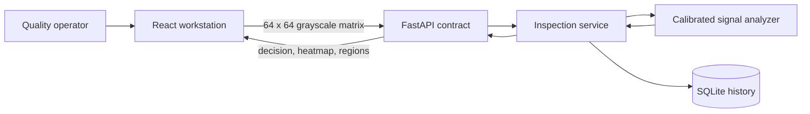

# Architecture

## Responsibilities

| Boundary | Responsibility                                                         |
| -------- | ---------------------------------------------------------------------- |
| Browser  | Image decoding, normalization, evidence visualization, operator flow   |
| API      | Contract validation, safe error responses, local CORS boundary         |
| Service  | Coordinate analysis and persistence without HTTP knowledge             |
| Vision   | Generate references, calibrate thresholds, produce explainable regions |
| Storage  | Persist compact inspection records in SQLite                           |

The uploaded source image never leaves the local machine. The API receives a
normalized grayscale matrix and stores only the decision summary. This reduces
the data footprint while keeping the release easy to inspect.

## Detection method

Nilik learns a robust signal boundary from known-good synthetic references. A
dependency-light feature combines local contrast residuals with gradient
discontinuities. Connected pixels above the calibrated boundary become review
regions. The global score and region evidence produce one of three decisions.

This baseline was chosen because it is deterministic, explainable, and easy to
replace. The service boundary can later host a learned embedding or segmentation
model without changing the browser contract or persistence layer.
